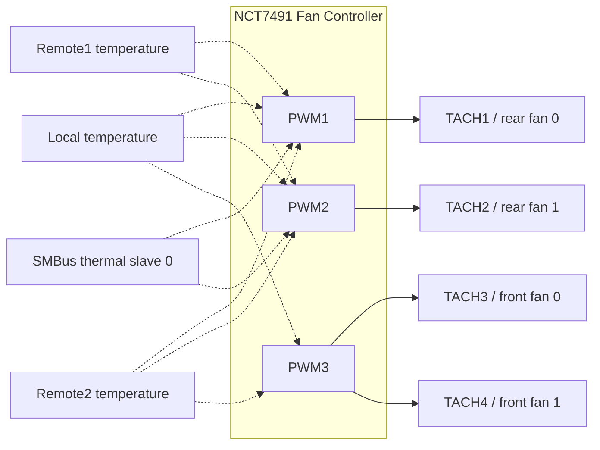

# hpz-ecfan

**Write-up:** [Controlling HP Z840 chassis fans from Linux](https://blog.codeverse.nl/hp-z840-fan-control-linux/)

**Status: works on the HP Z840 (tested live); other Z-series boards untested, reports welcome.**

Chassis fan control for HP Z-series workstations (developed on a Z840, BIOS M60 v02.56)
from Linux, without a kernel module and without rebooting.

## Why this exists

On these machines the chassis fans are driven by an ON Semi **NCT7491** (ADT7475 family)
that sits on the *private* SMBus of the Nuvoton embedded controller. The PCH's `i2c-i801`
bus cannot reach it, so `lm-sensors`, `fancontrol` and the `adt7475` driver see nothing.
HP's ACPI/WMI only exposes the read side (the `hp-wmi-sensors` driver). The write side was
recovered from HP's `HhmDxe` firmware module, which programs the chip at every POST.

## How it works

The EC exposes a RAM window at I/O `0x800-0x8FE`, page-selected through `0x8FF`.
Page 0 contains a tiny SMBus proxy:

| byte | meaning |
|------|---------|
| `0xE5` | 7-bit device address |
| `0xE6` | bytes to read back (1 for a read, 0 for a write) |
| `0xE7` | bytes to send after the address (1: register, 2: register+data) |
| `0xE8` | data: register for a read (result returned here), value for a write |
| `0xE9` | register for a write |
| `0xF0` | bit 0: write 1 to start, EC clears it on completion |

Read byte:  `E5=dev, E8=reg, E7=1, E6=1, F0=1`, poll `F0.0==0`, result in `E8`
Write byte: `E5=dev, E8=val, E9=reg, E7=2, E6=0, F0=1`, poll `F0.0==0`

There is no error flag. A NACK still clears `F0.0` and leaves `E8` untouched, so every
write is verified by reading the register back. All transactions are serialised through an
`flock` (`/var/lock/ecmbox`, override with `--lock` or `HPZ_EC_LOCK`); two unsynchronised
users *will* corrupt each other's data byte.

Fan control stays inside the chip's own automatic loop: the tool moves the floor (`PWMmin`)
or the knee (`Tmin`) of the temperature curve rather than switching to manual duty, so if
the tool dies the fans keep working. THERM limits stay armed regardless. Every failure
direction is toward faster fans.

## Install

```
git clone https://github.com/kiwimato/hpz-ecfan
cd hpz-ecfan && pip install .        # or just run it in place with python3 -m
```

Standard library only, Python ≥ 3.9.

## Usage (root)

```
python3 -m hpz_ecfan.cli status
python3 -m hpz_ecfan.cli dump                 # registers 0x00-0x9F
python3 -m hpz_ecfan.cli set-min 3 0x60       # front fans (PWM3) floor to 37% duty
python3 -m hpz_ecfan.cli set-min 1 0x80       # rear fan 0 (PWM1)
python3 -m hpz_ecfan.cli set-tmin local 35    # start the curve earlier
python3 -m hpz_ecfan.cli log --interval 30
```

Z840 wiring: tach1/tach2 = rear fans on PWM1/PWM2, tach3/tach4 = front fans (both on PWM3).
Other Z-series boards likely share the EC and the mailbox but may wire fans differently;
check `dump` and `status` before writing. The tool refuses to run on non-HP-Z DMI product
names unless `--force` is given.

Needs `/dev/port` (root or `CAP_SYS_RAWIO`).

### Z840 fan and temperature mapping

Temperature zones control the PWM outputs they are assigned to. The Z840 zone registers
assign local, remote1, and remote2 to PWM1 and PWM2; PWM3 is assigned local and remote2.
PWM1 and PWM2 are also associated with SMBus thermal slave 0.



Dashed arrows show temperature-zone control assignments, not physical sensor wiring. For
each PWM output, the NCT7491 calculates a PWM request for each assigned temperature zone
using that zone's control curve, then outputs the highest calculated PWM value. Thus, a
hotter zone can raise the fan speed even if the other zones request less. A THERM event can
override this control, and a PWM channel with no assigned temperature zones is in manual mode.

For PWM output `j`, let `Z_j` be its assigned temperature zones. The output is the highest
request calculated for those zones:

$$
PWM_{out,j} = \max_{i \in Z_j} PWM_{j,i}(T_i)
$$

Here, `PWM_{j,i}(T_i)` is the PWM request for output `j` calculated from temperature zone `i`;
the curve below shows the approximate calculation for one such request.

The curve below illustrates one temperature zone controlling one PWM output. `Tmin` is
the temperature where the output reaches `PWMmin`; over `Trange`, it rises to `PWMmax`.
Below `Tmin`, the output behavior depends on configuration, and a THERM event can override
the curve.

The datasheet defines these endpoints and the temperature span, but does not give an explicit
equation for this mode. As a useful linear approximation, for `Tmin <= T <= Tmin + Trange`:

$$
PWM(T) \approx PWM_{min} + (PWM_{max} - PWM_{min}) \frac{T - T_{min}}{T_{range}}
$$

Here, PWM values can be expressed either as register values or percentages, as long as the
same units are used throughout. This approximation does not describe behavior below `Tmin`,
or overrides such as a THERM event.

```text
PWM duty
100% |                                      -------- PWMmax
  |                                  ___/
  |                              ___/
  |                          ___/
PWMmin|------------------------*
  |                       Tmin
  0% +------------------------+------------------------+-- Temperature
             Tmin                 Tmin + Trange
```

This is an illustrative curve, not a plot of live readings. `set-tmin local 35` sets the
local zone's `Tmin` to 35 C; it does not set a PWM duty or RPM. `set-min` changes the
PWM output's minimum duty. When multiple temperature zones are assigned to one PWM output,
the chip applies its automatic control behavior to those inputs.

## Docker (hosts without Python, e.g. Unraid)

The image needs only `/dev/port` and `CAP_SYS_RAWIO`, not `--privileged`:

```
git clone https://github.com/kiwimato/hpz-ecfan && cd hpz-ecfan
docker compose build
docker compose run --rm hpz-ecfan status          # one-shot commands
docker compose run --rm hpz-ecfan set-min 3 0x60
docker compose up -d logger                       # status line every 30 s in `docker logs`
```

Without compose:

```
docker build -t hpz-ecfan .
docker run --rm --network none --cap-drop ALL --cap-add SYS_RAWIO \
  --device /dev/port -v /var/lock:/lock -v /sys/class/dmi/id:/sys/class/dmi/id:ro \
  hpz-ecfan status
```

`/lock` must be a host directory shared by *every* mailbox user (other containers, shell
scripts, cron), because the flock in it is what keeps transactions from interleaving. Set
`HPZ_LOCK_DIR` to move it (on Unraid, `/boot/config` survives reboots, `/var/lock` does not
need to). Unraid ships Docker without the compose plugin; use the plain `docker` commands there
(tested on Unraid 7.3 with exactly the flags above).

Full protocol and the verification record: [docs/protocol.md](docs/protocol.md).
Contributor and AI-agent rules: [AGENTS.md](AGENTS.md).

## Safety notes

* Config1 (`0x40`) bit 1 is the chip's LOCK bit; once set, configuration is read-only until
  a power cycle. The tool refuses writes if it is set. Never write `0x40` blindly.
* Clearing STRT (`0x40` bit 0) sends all PWMs to 100%.
* A power cycle resets both the EC and the chip to BIOS defaults; a warm reboot re-runs POST,
  which rewrites the chip anyway.

## Acknowledgements

Register-level knowledge of the NCT7491 comes from the public ON Semiconductor datasheet;
the read side of the EC proxy from HP's own ACPI tables. Nothing here reproduces HP code.

## License

MIT, see [LICENSE](LICENSE).
